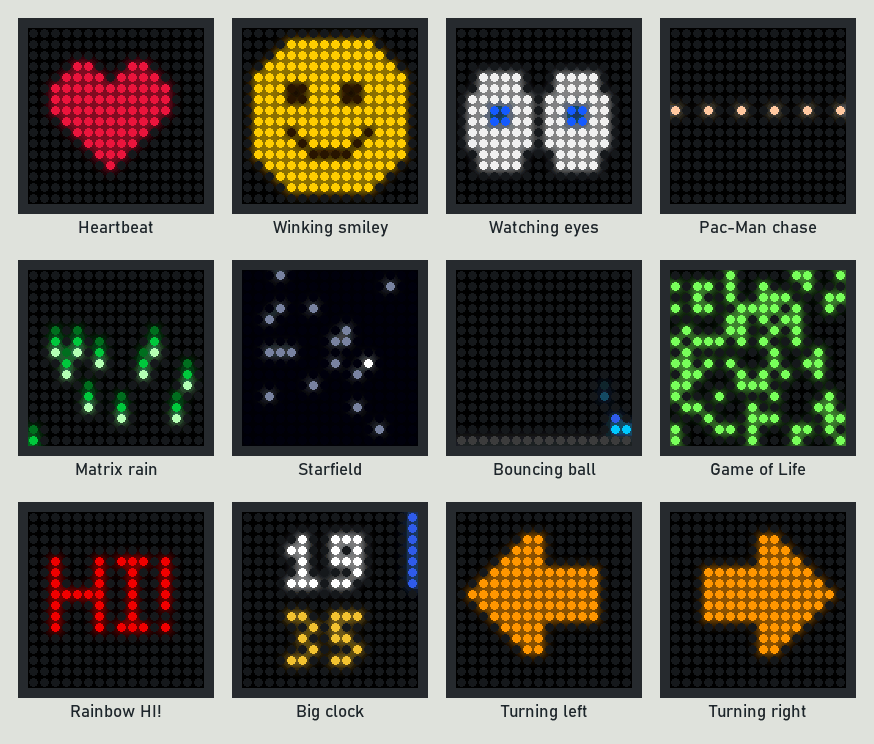
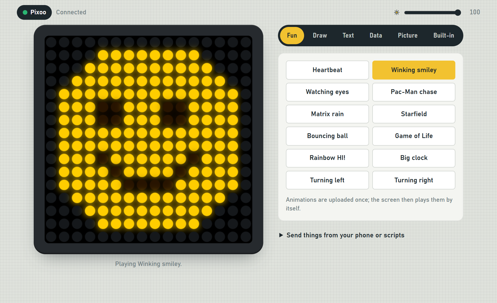
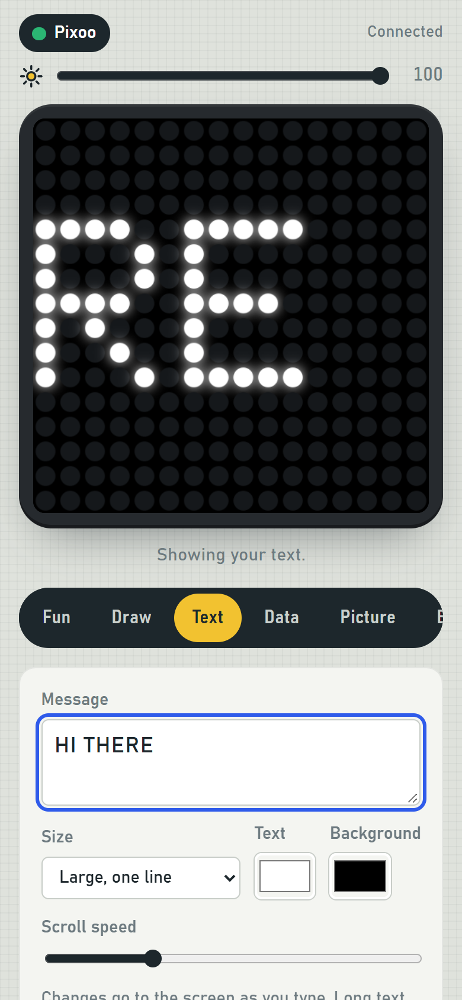
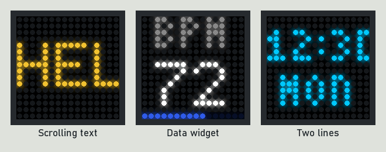
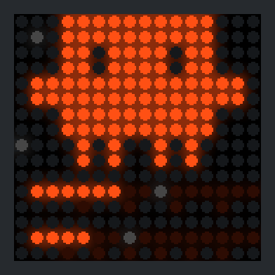
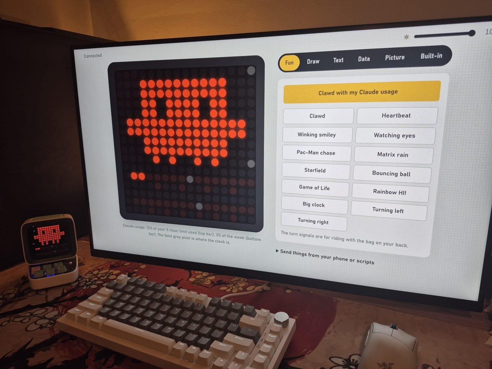

# divoom-ble-web

Control the screen of a Divoom 16×16 pixel display (Pixoo, Ditoo, Timoo, …) from a web page or a simple HTTP API, over Bluetooth LE, without the Divoom app.



## Features

- **A web page**, for your phone or computer: draw on the screen, type scrolling text, show a value with a label and a bar, upload pictures and animated GIFs, play built-in animations, switch the device's own modes, and change the brightness.
- **An HTTP and WebSocket API**, so scripts, phone shortcuts and home-automation tools can update the screen.
- **Several screens at once**, each with its own content. The page has a switcher.
- **Clean updates.** Still content is sent as one full image and swaps in instantly. Animations are uploaded once and then play on the device by themselves, smoothly.
- **Keeps the connection.** If a device is switched off or goes out of range, it reconnects by itself.

| On a computer | On a phone |
|---|---|
|  |  |

## Tested devices

| Device | Status |
|---|---|
| Divoom Pixoo SlingBag | Works |
| Divoom Ditoo Plus | Works |

Other 16×16 Divoom devices that use the same Bluetooth LE service (`49535343-fe7d-…`) will probably work too. If you try one, please open an issue saying how it went.

## Requirements

- Python 3.10 or newer.
- A computer with Bluetooth LE. Developed and tested on Windows 11. Bluetooth access goes through [bleak](https://github.com/hbldh/bleak), which also supports Linux and macOS, but those haven't been tested yet.

## Quick start

```sh
git clone https://github.com/alikendir0/divoom-ble-web.git
cd divoom-ble-web
python -m venv .venv
.venv\Scripts\activate          # Windows
# source .venv/bin/activate     # Linux / macOS
pip install -e .
```

1. Turn the screen on and close the Divoom app on your phone. A device accepts only one Bluetooth connection at a time.
2. Find its address:
   ```sh
   divoom-ble --scan
   ```
   ```
     11:22:33:44:55:66  Pixoo-SlingBag  (signal -58 dBm)
   ```
3. Start the server:
   ```sh
   divoom-ble --device 11:22:33:44:55:66
   ```
4. Open the address it prints: `http://localhost:8080/` on the same computer, or `http://<computer-ip>:8080/` from your phone on the same Wi-Fi. The first time, Windows may ask whether Python can use the network; allow it on private networks.

### Several screens

Give each one a name, and optionally a title for the page:

```sh
divoom-ble --device bag=11:22:33:44:55:66="Backpack" --device desk=AA:BB:CC:DD:EE:FF="Desk"
```

### Options

| Option | Meaning |
|---|---|
| `--device [NAME=]MAC[=TITLE]` | A screen to control. Repeat it for several. The `DIVOOM_DEVICE` environment variable also works. |
| `--scan` | List nearby Divoom devices and exit. |
| `--port 8080` | Web server port (or `DIVOOM_PORT`). |
| `--host 0.0.0.0` | `0.0.0.0` lets other devices on your network open the page; `127.0.0.1` keeps it to this computer. |
| `--token SECRET` | Require a token on every request (or `DIVOOM_TOKEN`). Open the page as `http://…:8080/?token=SECRET`. |
| `-v` | Debug logging. |

Anyone on your network can use the page unless you set `--token`.

## The web page

| Tab | What it does |
|---|---|
| **Fun** | Ready-made animations: heartbeat, winking smiley, watching eyes, Pac-Man, Matrix rain, starfield, bouncing ball, Game of Life, rainbow text, a big clock, and left/right turn signals. |
| **Draw** | Paint pixels with a pen, eraser, fill or colour picker. Each stroke appears on the screen as you draw. |
| **Text** | Type a message and it appears as you type; long text scrolls. Large single-line or small two-line text. |
| **Data** | A label, a big value and an optional bar. Useful for numbers sent by scripts. |
| **Picture** | Upload a picture or animated GIF. It's scaled to 16×16, cropped to fill or fitted whole. |
| **Built-in** | Hand the screen back to the device's own modes: clock, cloud gallery, visualizer, effects, lamp. |



## HTTP API

Every action on the page is also an HTTP endpoint. Send JSON with `POST`. CORS is open, so web pages and phone apps can call it directly. With several screens, add `?device=<name>`; without it the first screen is used.

| Endpoint | Body | Shows |
|---|---|---|
| `POST /api/text` | `{"text": "On my way", "color": "#f2c230", "bg": "#000", "font": "big" \| "small", "speed": 14}` | Text; long text scrolls |
| `POST /api/value` | `{"label": "BPM", "value": "72", "bar": 0.6, "color": "#fff", "label_color": "#888", "bar_color": "#2f5bea"}` | A data widget (`bar` from 0 to 1, or omit it) |
| `POST /api/pixels` | `{"pixels": ["ff0000", …]}` | 256 colours, row by row from the top left |
| `POST /api/paint` | `{"changes": [[index, "#rrggbb"], …]}` | Changes some pixels; `index = y * 16 + x` |
| `POST /api/fill` | `{"color": "#000000"}` | One colour everywhere |
| `POST /api/image` | multipart field `file` (PNG, JPG, GIF), optional `fit=cover\|contain` | A picture or animation |
| `POST /api/preset` | `{"name": "heartbeat"}` | A built-in animation (`GET /api/presets` lists them) |
| `POST /api/channel` | `{"kind": "clock" \| "cloud" \| "visualizer" \| "vj" \| "light" \| "custom", "index": 0, "color": "#ffb347"}` | The device's own modes |
| `POST /api/brightness` | `{"value": 0-100}` | Changes the brightness |
| `GET /api/state` | – | Connection, brightness, what's showing, and the current frame |
| `GET /api/devices` | – | The configured screens and whether each is connected |
| `WS /ws` | the same messages as JSON with a `"type"` field | Live frame and state updates |

```sh
curl -X POST http://localhost:8080/api/value -H "Content-Type: application/json" \
     -d '{"label": "TEMP", "value": "21°", "bar": 0.4}'
```

For numbers that change often, use `/api/value` or `/api/pixels`. Both send one still image, and the screen shows it within about 0.1 to 0.4 seconds. Text that scrolls and animations are uploaded to the device each time they change, which takes 0.1 to 2 seconds while the device shows a loading symbol. They suit content that changes now and then.

## How it works

- **Bluetooth:** commands go over the device's Bluetooth LE serial service, in the framing the Divoom app uses. The device acknowledges each command, and the server waits for that before sending the next.
- **Still frames** (drawing, data, pictures): each one is sent as a single full-screen image (command `0x44`), so the screen changes in one step. Only the newest frame is sent; frames that were waiting are skipped.
- **Animations:** uploaded once as a native animation (command `0x8B`), which the device then loops by itself. An upload takes about 4 KB/s, so the built-in animations are kept small (under 5 KB, about 1 second).

The full protocol notes, including device quirks, are in [docs/protocol.md](docs/protocol.md).

## Make your own animation

A scene is a class with a `render(t)` method that returns 256 `(r, g, b)` tuples for time `t`. Add one to `divoom_ble/presets.py`, and it appears in the Fun tab:

```python
def blink(t, state):
    on = (t % 1.0) < 0.5
    return [(255, 0, 0) if on else (0, 0, 0)] * 256

PRESETS["blink"] = ("Red blink", 0.5, 1.0, blink)   # title, seconds per frame, loop length, function
```

## Examples

- **[Claude usage screen](examples/claude_usage/)**: a background app that shows Claude Code's 5-hour and weekly usage limits as two bars, with an animated Clawd, the Claude Code mascot. Tested on a Ditoo Plus and a Pixoo SlingBag.

  | The screen | On a Ditoo Plus |
  |---|---|
  |  |  |

## Troubleshooting

| Problem | Fix |
|---|---|
| `--scan` finds nothing, or the server keeps retrying | Close the Divoom app on your phone, and on any other computer. Turn the screen off and on, and keep it within a few metres. |
| The page doesn't open from the phone | The phone has to be on the same network. Allow Python through the firewall on private networks, and use the address the server printed. |
| A loading symbol appears for a moment | That's an animation upload. Still content (drawing, data, pictures) never shows it. |
| The screen goes back to its own mode | Someone pressed a button on the device. The page leaves the screen to the device until you send something new. |

## Contributing

Bug reports and pull requests are welcome, especially results from devices that haven't been tested. Run the tests with:

```sh
pip install -e ".[dev]"
pytest
```

## License

[MIT](LICENSE). This project is not affiliated with Divoom. Divoom, Pixoo and Ditoo are trademarks of their owners.
